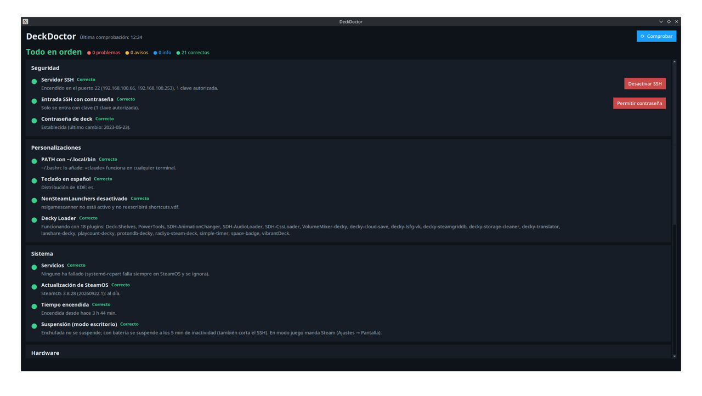
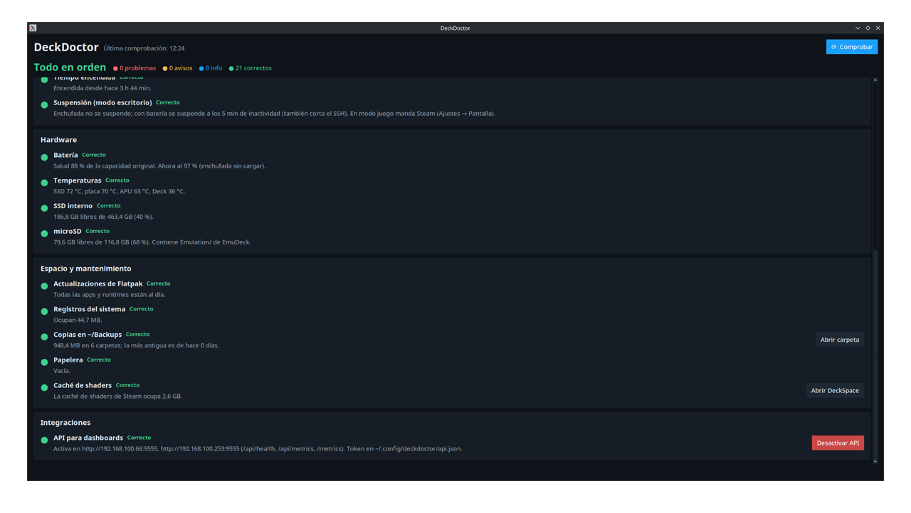

# DeckDoctor

Chequeo de **salud de la Steam Deck**. Revisa seguridad, personalizaciones que una actualización de
SteamOS podría deshacer, servicios, hardware y mantenimiento. Muestra cada punto con un semáforo y,
cuando hay un arreglo seguro, un botón para aplicarlo.

Además tiene una **[API de estadísticas](#api-para-dashboards)** opcional: publica en la red local el estado de la
Deck (batería, temperaturas, espacio, juegos instalados…) en JSON y en formato Prometheus, para verlo en un
dashboard propio o en Grafana.

| Seguridad, personalizaciones y sistema | Hardware, mantenimiento e integraciones |
|---|---|
|  |  |

## Instalación
Funciona en la Steam Deck (SteamOS, modo escritorio). Varias comprobaciones son de SteamOS (`steamos-update`,
sensores de la Deck); en otro Linux esas se muestran como info o no aparecen.

**Requisitos**: Python 3 con Tkinter y `pkexec` (vienen con SteamOS). No hace falta `sudo` para instalar.

En la Deck, en modo escritorio, abre **Konsole** y escribe:
```bash
git clone https://github.com/drarekx/DeckDoctor.git ~/Apps/DeckDoctor
~/Apps/DeckDoctor/install.sh --desktop
```
Después abre **DeckDoctor** desde el menú de aplicaciones (o el icono del Escritorio).

Sin `git`, descarga el `.tar.gz` de la última versión en
[Releases](https://github.com/drarekx/DeckDoctor/releases), descomprímelo en `~/Apps/DeckDoctor` y ejecuta `install.sh`.

- **Actualizar**: `git -C ~/Apps/DeckDoctor pull`. La ventana abierta se recarga sola al pulsar «Comprobar»; si
  usas la API, `systemctl --user restart deckdoctor-api`.
- **Desinstalar**: `~/Apps/DeckDoctor/install.sh --uninstall` (quita también la API si estaba activada) y borrar
  `~/Apps/DeckDoctor` y `~/.config/deckdoctor`.
- **API para dashboards**: no se activa al instalar. Se activa con el botón «Activar API» de la app.
- **Comprobación del teclado** (opcional): crea `~/.config/deckdoctor/config.json` con `{"keyboard": "es"}` (o la
  distribución que uses) y DeckDoctor avisará si una actualización la cambia.
- El botón «Abrir DeckSpace» necesita [DeckSpace](https://github.com/drarekx/DeckSpace) en `~/Apps/DeckSpace`.

## Uso
- Abrir **DeckDoctor** desde el menú (Utilidades/Sistema) o desde el icono del Escritorio. Comprueba todo al abrirse
  (menos de 1 s) y con **⟳ Comprobar**.
- Arriba aparece el resumen: «Todo en orden», «N avisos que revisar» o «N problemas por arreglar», y el recuento
  por estado.
- Cada punto tiene ● de color: rojo = problema, amarillo = aviso, azul = info, verde = correcto.
- Los botones de la derecha aplican el arreglo:
  - Los que borran o desactivan algo (rojos) piden confirmación antes.
  - Al terminar se vuelve a comprobar todo.
  - Los errores se muestran en un diálogo.
- Terminal: `python3 ~/Apps/DeckDoctor/deckdoctor.py --check` imprime el informe sin ventana. Sale con código 1
  si hay algún problema (rojo). Sirve para scripts o un futuro plugin de Decky.

## Comprobaciones
| Grupo | Punto | Criterio | Arreglo |
|-------|-------|----------|---------|
| Seguridad | Servidor SSH (`ssh`) | Siempre verde: indica si está encendido, sus IP y cuántas claves hay | Encendido: **Desactivar SSH** (`pkexec systemctl disable --now sshd`). Apagado: **Activar SSH** (`enable --now`) |
| Seguridad | Entrada SSH con contraseña (`ssh_password`) | Verde si solo se entra con clave. Si se permite la contraseña: aviso con SSH encendido, info con SSH apagado | Permitida y con claves: **Solo con clave** (escribe `/etc/ssh/sshd_config.d/10-solo-clave.conf`, valida con `sshd -t` y recarga si está encendido; si falla, lo quita). Solo clave: **Permitir contraseña** (borra el archivo). Sin claves no hay botón, para no dejarte fuera |
| Seguridad | Contraseña de deck | `passwd -S` | — |
| Personalizaciones | PATH con `~/.local/bin` | Solo si existe `~/.local/bin`: `~/.bashrc` contiene `.local/bin` | Añade el bloque `case` al final de `~/.bashrc` |
| Personalizaciones | Teclado | Solo si `config.json` tiene `"keyboard"` (p. ej. `"es"`): `LayoutList` de `~/.config/kxkbrc` empieza por esa distribución | `kwriteconfig6` + señal D-Bus `reloadConfig` |
| Personalizaciones | NonSteamLaunchers desactivado | Solo si está instalado: `nslgamescanner.service` de usuario desactivado e inactivo (si no, reescribe los accesos no de Steam) | `systemctl --user disable --now` |
| Personalizaciones | Decky Loader | Existe `~/homebrew` y `plugin_loader` está activo; lista los plugins. Si no está instalado, solo info | Reiniciar el servicio (`pkexec`) |
| Sistema | Servicios | `systemctl --failed` (sistema y usuario), ignorando `systemd-repart.service` | — |
| Sistema | Actualización de SteamOS | `steamos-update check` | — (se instala en modo juego) |
| Sistema | Suspensión (modo escritorio) | `AutoSuspendAction` de `[AC][SuspendAndShutdown]` en `~/.config/powerdevilrc` (o `/etc/xdg/powerdevilrc`): aviso si es distinto de 0 | No suspender enchufada (`kwriteconfig6` + `reparseConfiguration`) |
| Sistema | Tiempo encendida | Info a partir de 7 días | — |
| Sistema | Sesión | Modo juego o escritorio y el juego abierto, con el tiempo que lleva. Con la API activa, también lo jugado hoy y en 7 días y el juego más jugado (siempre correcto, es informativo) | — |
| Hardware | Batería | Salud = `charge_full / charge_full_design`: verde ≥ 80 %, amarillo ≥ 65 % | — |
| Hardware | Rendimiento ahora (`perf`) | CPU, RAM, GPU (uso y MHz), consumo de la APU frente a su límite, ventilador, gasto de batería y tiempo que queda, señal Wi-Fi y batería de los mandos inalámbricos. Aviso si un mando está al 15 % o menos | — |
| Hardware | Temperaturas | Máximo de los `hwmon` acpitz, steamdeck_hwmon, nvme y amdgpu: amarillo ≥ 85 °C, rojo ≥ 95 °C | — |
| Hardware | SSD interno / microSD | Libre: amarillo < 10 %, rojo < 5 %. Aviso si la microSD no está montada | Abrir DeckSpace |
| Mantenimiento | Actualizaciones de Flatpak | `flatpak remote-ls --updates` | `flatpak update -y --noninteractive` |
| Mantenimiento | Registros del sistema | `journalctl --disk-usage`, aviso a partir de 1 GB | — |
| Mantenimiento | Copias en `~/Backups` | Info si pasan de 1 GB y tienen más de 30 días | Abrir carpeta |
| Mantenimiento | Papelera | Aviso a partir de 1 GB | Vaciar (`gio trash --empty`) |
| Mantenimiento | Caché de shaders | Info a partir de 5 GB | Abrir DeckSpace |
| Integraciones | API para dashboards | Servicio `deckdoctor-api` activo (muestra las URL de la red local) | Activar API / Desactivar API |

## API para dashboards
Servicio de usuario de systemd (`deckdoctor-api.service`) que arranca con la Deck, también en modo juego. Expone el
estado por HTTP a la red local. Es **solo lectura**: los arreglos no se pueden ejecutar desde fuera.

### Inicio rápido
1. Abre DeckDoctor y, en «Integraciones», pulsa **Activar API**. Desde ese momento arranca sola con la Deck.
2. En la misma tarjeta aparecen las direcciones (`http://<IP de la Deck>:9555`).
3. Saca el token en una terminal de la Deck:
   ```bash
   python3 -c "import json,os;print(json.load(open(os.path.expanduser('~/.config/deckdoctor/api.json')))['token'])"
   ```
4. Prueba desde otro equipo de la red:
   ```bash
   curl http://<IP de la Deck>:9555/api/ping                                   # sin token: ¿está encendida?
   curl -H "Authorization: Bearer <token>" http://<IP de la Deck>:9555/api/health
   ```
5. Para desactivarla: botón **Desactivar API** en la misma tarjeta.

### De dónde salen los datos
Todo se lee de la propia Deck, sin servicios externos. La API ejecuta las mismas comprobaciones que la ventana cada
`interval` segundos y guarda el resultado; cada petición solo devuelve lo último guardado.

| Dato | Fuente |
|------|--------|
| Batería (carga, salud, ciclos, enchufada) | `/sys/class/power_supply/BAT1` |
| Temperaturas (APU, SSD, placa, Deck) | Sensores del kernel en `/sys/class/hwmon/` |
| Espacio libre del SSD y la microSD | `shutil.disk_usage` |
| Tiempo encendida | `/proc/uptime` |
| CPU y RAM | `/proc/stat` (dos lecturas separadas 0,25 s) y `/proc/meminfo` |
| GPU, consumo y límite de la APU | `hwmon` de `amdgpu`: `power1_average`, `power1_cap` (TDP), `freq1_input`, `gpu_busy_percent`, `mem_info_vram_used` |
| Ventilador | `hwmon` de `steamdeck_hwmon`: `fan1_input` |
| Gasto de batería y tiempo restante | `BAT1`: `current_now` × `voltage_now` y `charge_now` / `current_now` (solo descargando) |
| Wi-Fi, red y mandos | `/proc/net/wireless`, `/sys/class/net/*/operstate` y `power_supply` con `scope=Device` |
| Historial de partidas | Lo escribe la propia API (ver «Partidas» más abajo) |
| Modo juego y juego abierto | `gamescope-session.target` (modo juego) o `plasmashell` (escritorio); el juego, del proceso `reaper SteamLaunch AppId=N` que Steam pone delante de cada juego, y su nombre de `appmanifest_N.acf` o `shortcuts.vdf`. Se calcula **en cada petición**, no cada `interval` (igual que el rendimiento) |
| SSH (activo, contraseña, claves) | `systemctl` y `/etc/ssh/sshd_config*` |
| Servicios fallidos | `systemctl --failed` |
| Decky Loader y sus plugins | `~/homebrew` y el servicio `plugin_loader` |
| Registros, copias, papelera, caché de shaders | `journalctl --disk-usage` y el tamaño de esas carpetas |
| Actualizaciones de SteamOS y Flatpak | `steamos-update check` y `flatpak remote-ls --updates` (consultan internet: cada `slow_interval`) |
| Juegos instalados y su tamaño | DeckSpace: `appmanifest_*.acf`, `shortcuts.vdf` y `du` (ver «Juegos» más abajo) |

### Referencia

- **Dirección:** `http://<IP de la Deck>:9555`. DeckDoctor muestra las IP que tiene en ese momento (cable y Wi-Fi).
  Conviene reservarlas en el router para que no cambien; si la Deck usa a veces cable y a veces Wi-Fi, el
  dashboard puede probar las dos.
- **Token:** en `~/.config/deckdoctor/api.json` (permisos 600). Se envía como `Authorization: Bearer <token>` o
  `?token=<token>`. Para cambiarlo, vaciar `"token"` y reiniciar el servicio: se genera uno nuevo.
- **Configuración** (`api.json`): `port` (9555), `bind` (`0.0.0.0`), `interval` (300 s entre comprobaciones),
  `slow_interval` (21600 s para SteamOS y Flatpak, que consultan internet), `games_interval` (3600 s entre análisis
  completos de los juegos), `token`.
  Después de cambiarla: `systemctl --user restart deckdoctor-api`.
- Las comprobaciones se hacen en segundo plano y se guardan, así que consultar a menudo no carga la Deck.
  Con la Deck suspendida o apagada no responde: el dashboard debe tratarlo como «sin datos».

| Ruta | Token | Devuelve |
|------|-------|----------|
| `GET /api/ping` | No | `{"ok": true, "version": "1.2"}`; sirve para saber si está encendida |
| `GET /api/health` | Sí | Todo: `host`, `checked_at`, `summary` (`status` = peor estado y `counts`), `session` (ver abajo), `metrics` (plano) y `checks` (id, grupo, título, estado, detalle, nombre del arreglo y métricas de cada punto) |
| `GET /api/metrics` | Sí | Solo `checked_at`, `status`, `session` y `metrics` planas, por ejemplo `{"battery_charge_percent": 97, "temperature_celsius": {"apu": 54, …}, "disk_free_bytes": {"ssd": …, "sd": …}}` |
| `GET /metrics` | Sí | Formato Prometheus, con prefijo `deckdoctor_` |
| `GET /api/sessions?days=7` | Sí | Historial de partidas (ver abajo). `days` de 1 a 3650 |
| `GET /api/games` | Sí | Juegos instalados (necesita [DeckSpace](https://github.com/drarekx/DeckSpace); sin ella, `{"available": false}`). Ver abajo |
| `POST /api/refresh` | Sí | Repite todas las comprobaciones ahora, incluidas las lentas y el análisis de juegos (202) |

Los `id` de las comprobaciones son estables: `ssh`, `ssh_password`, `password`, `path`, `keyboard`, `nsl`, `decky`, `failed`
(o `failed_system`/`failed_user`), `steamos`, `uptime`, `session`, `battery`, `perf`, `temps`, `disk_ssd`, `disk_sd`, `flatpak`,
`journal`, `backups`, `trash`, `shaders` y `api`. Estados: `ok`, `info`, `warn` y `bad`.

**Sesión (`session` en `/api/health` y `/api/metrics`):** `{"mode": "game"|"desktop"|"none", "game": null}` o, con
un juego abierto, `"game": {"appid": "892970", "name": "Valheim", "kind": "steam"|"non_steam", "since": <Unix>,
"seconds": 1520}`. Si hay varios, el abierto más tarde. Los accesos no de Steam tienen `appid` ≥ 2³¹ y el nombre sale
de `shortcuts.vdf` (sin `.exe`).

**Partidas (`/api/sessions`):** el servicio de la API mira cada 15 s qué juego hay abierto. Al cerrarse, añade la
partida a `~/.config/deckdoctor/sessions.jsonl`; la partida en curso se guarda en `session_current.json`, así no se
pierde si la Deck se apaga o se reinicia la API con el juego abierto.
- `seconds` es tiempo **despierta**: si entre dos lecturas pasan más de 45 s, la Deck estuvo suspendida y no se suma.
  Las partidas de menos de 30 s no se guardan (juegos que no llegaron a arrancar).
- Solo hay historial desde que se activó la API y mientras está en marcha.
- Respuesta: `today_seconds`, `period_seconds` (los últimos `days`), `current` (partida en curso o `null`), `by_game`
  (`appid`, `name`, `kind`, `seconds`, `sessions`, `last`; de más a menos jugado) y `sessions` (de la más reciente a
  la más antigua: `appid`, `name`, `kind`, `mode`, `start`, `end`, `seconds`). Una partida que cruza la medianoche
  cuenta en cada día en proporción.

**Juegos (`/api/games`):** la API importa `deckspace.py` (de `~/Apps/DeckSpace` o de una carpeta `DeckSpace` junto a
DeckDoctor) y reutiliza su lectura de Steam, sin duplicar código:
- La **lista** (`installed_games()` y `shortcuts()`: `appmanifest_*.acf` y `shortcuts.vdf`, solo lectura) se lee en
  cada comprobación, así que un juego instalado o borrado aparece en 5 minutos.
- Los **tamaños completos** (`analyze()`: datos de Proton y caché de shaders medidos con `du`, y el espacio
  recuperable) se calculan en un hilo aparte cada `games_interval`, con prioridad baja (`nice` 10) para no frenar la
  Deck. Hasta el primer análisis, `proton_bytes` y `shader_bytes` valen `null`.
- Respuesta: `listed_at`, `sized_at`, `summary` (`games`, `tools` = Proton y runtimes, `non_steam`, `bytes_by_drive`,
  `total_bytes`, `unplayed_6m`, `recoverable_bytes`), `games` (por juego: `appid`, `name`, `drive`, `tool`, `installed`,
  `last_played`, `game_bytes`, `proton_bytes`, `shader_bytes`, `total_bytes`; de mayor a menor) y `non_steam`
  (`appid`, `name`).
- En las métricas y en Prometheus solo van los totales (una serie por juego sería demasiado para Prometheus).

**Métricas:**
- `check_status{id,group,title}` (0 ok, 1 info, 2 aviso, 3 problema) y `checks{status}`.
- `battery_health_percent`, `battery_charge_percent`, `battery_charging`, `battery_plugged` y `battery_cycles`
  (este solo si la Deck lo informa).
- `temperature_celsius{sensor=apu|ssd|board|deck}`.
- `disk_free_bytes{disk=ssd|sd}`, `disk_total_bytes{disk}` y `sd_mounted`.
- `ssh_active`, `ssh_password_auth`, `ssh_keys`, `suspend_on_ac`, `decky_active`, `decky_plugins`, `failed_units{scope}`,
  `steamos_update_available` y `flatpak_updates`.
- Sesión (en vivo): `session_game_mode`, `game_running`, `game_running_seconds` y, con un juego abierto,
  `game_playing{game,appid,kind}` = 1 (en el JSON plano: `{"game_playing": {"Valheim": 1}}`).
- Historial: `played_today_seconds` y `played_week_seconds` (incluyen la partida en curso).
- Rendimiento (en vivo): `perf_cpu_percent`, `perf_ram_used_bytes`, `perf_ram_total_bytes`, `perf_gpu_percent`,
  `perf_gpu_mhz`, `perf_vram_used_bytes`, `perf_apu_watts`, `perf_apu_watts_limit`, `perf_fan_rpm`,
  `perf_battery_watts`, `perf_battery_minutes_left` (solo descargando), `perf_wifi_signal_dbm`,
  `network_up{interface}` y `controller_battery_percent{controller}`.
- `uptime_seconds`, `journal_bytes`, `backups_bytes`, `backups_oldest_days`, `trash_bytes`, `shadercache_bytes` y
  `api_active`.
- Con DeckSpace: `games_installed{kind=steam|tool|non_steam}`, `games_bytes{drive}`, `games_unplayed_6m`,
  `games_recoverable_bytes` y `games_sized_timestamp_seconds`.
- `last_check_timestamp_seconds`, `last_slow_check_timestamp_seconds` y `check_duration_seconds`.

Ejemplo de configuración para Prometheus:
```yaml
scrape_configs:
  - job_name: steamdeck
    scrape_interval: 60s
    authorization: { credentials: "<token>" }
    static_configs: [{ targets: ["<ip-cable>:9555", "<ip-wifi>:9555"] }]  # cable y Wi-Fi
```

Ejemplo con curl: `curl -H "Authorization: Bearer <token>" http://<ip-de-la-deck>:9555/api/metrics`

### Ejemplos de respuesta
`GET /api/health` (recortado a una comprobación):
```json
{
  "host": "steamdeck",
  "version": "1.0",
  "checked_at": 1791801971.45,
  "summary": {"status": "ok", "counts": {"ok": 21, "info": 0, "warn": 0, "bad": 0}},
  "metrics": {"battery_charge_percent": 97.0, "temperature_celsius": {"apu": 61, "ssd": 73}, "…": "…"},
  "checks": [
    {
      "id": "battery", "group": "Hardware", "title": "Batería", "status": "ok",
      "detail": "Salud 88 % de la capacidad original. Ahora al 97 % (enchufada sin cargar).",
      "fix": null,
      "metrics": [
        {"name": "battery_health_percent", "value": 87.9, "labels": {}},
        {"name": "battery_charge_percent", "value": 97.0, "labels": {}},
        {"name": "battery_plugged", "value": 1.0, "labels": {}}
      ]
    }
  ]
}
```

`GET /api/games` (recortado a un juego):
```json
{
  "available": true,
  "listed_at": 1791801971.45,
  "sized_at": 1791801072.82,
  "summary": {
    "games": 31, "tools": 12, "non_steam": 41,
    "bytes_by_drive": {"SSD": 215418227836, "microSD": 15741934141},
    "total_bytes": 231160161977, "unplayed_6m": 22, "recoverable_bytes": 1393524275
  },
  "games": [
    {
      "appid": "1371980", "name": "No Rest for the Wicked", "drive": "SSD", "tool": false, "installed": true,
      "last_played": 1771365921, "game_bytes": 48428628501, "proton_bytes": 362369024,
      "shader_bytes": 124440576, "total_bytes": 48915438101
    }
  ],
  "non_steam": [{"appid": "2909933050", "name": "Azahar (Emulator)"}]
}
```
Las fechas son Unix (segundos) y los tamaños, bytes.

## Archivos
| Ruta | Qué es |
|------|--------|
| `deckdoctor.py` | Toda la app (Python estándar + Tkinter) |
| `deckdoctor_api.py` | Servidor de la API (importa `deckdoctor` y reutiliza sus comprobaciones) |
| `deckdoctor-api.service` | Plantilla del servicio; «Activar API» la copia a `~/.config/systemd/user/` con la ruta real de la app |
| `install.sh` | Crea o quita los accesos directos (y la API al desinstalar) |
| `docs/` | Capturas de pantalla |
| `README.md` | Esta documentación |
| `LICENSE` | Licencia BSD de 3 cláusulas |
| `NOTAS.md` | Notas privadas de esta Deck (no se sube a GitHub) |
| `~/.config/deckdoctor/config.json` | Preferencias opcionales: `{"keyboard": "es"}` activa la comprobación del teclado |
| `~/.config/deckdoctor/api.json` | Configuración y token de la API |
| `~/.config/deckdoctor/sessions.jsonl` | Historial de partidas, una por línea (lo escribe la API) |
| `~/.config/deckdoctor/session_current.json` | Partida en curso (se borra al cerrar el juego) |
| `~/.local/share/applications/deckdoctor.desktop` | Acceso directo del menú |
| `~/Desktop/deckdoctor.desktop` | Copia del acceso directo en el Escritorio |

## Arquitectura del código
- Cada comprobación es una función `check_*()` que devuelve una lista de `result(group, title, status, detail, fix)`.
  - `status` puede ser `ok`, `info`, `warn` o `bad`.
  - `fix` es un dict `{label, fn, confirm?, danger?}`. `fn()` devuelve un mensaje o lanza una excepción.
- Además, cada resultado lleva `id` (estable, para la API) y `metrics`: una lista de `metric(name, value, **labels)`.
  Si una comprobación devuelve varios resultados, cada uno lleva su `id` explícito (`disk_ssd`, `disk_sd`…).
- API: `State` guarda los últimos resultados. Un hilo los refresca: las comprobaciones `SLOW` (SteamOS y Flatpak)
  van aparte y con otro intervalo; las `LIVE` (sesión y rendimiento) se ejecutan en cada petición dentro de `snapshot()`. `SessionTracker`
  lleva el historial de partidas en otro hilo; `play_summary()` (en `deckdoctor.py`) lo resume para la ventana y la API.
  `ThreadingHTTPServer` solo lee esos datos. En Prometheus las muestras se agrupan
  por familia, porque el formato exige que cada métrica vaya seguida. Las descripciones están en `METRIC_HELP`.
  Para una métrica nueva, añadir su descripción ahí.
- Para añadir una comprobación: escribir la función y añadirla a `CHECKS`. Si es de un grupo nuevo, añadirlo a `GROUPS`.
- `run_all()` ejecuta todas en paralelo (8 hilos) y las ordena por grupo y gravedad. Se puede probar sin ventana:
  `import deckdoctor; deckdoctor.run_all()`.
- `sh()` ejecuta órdenes con tiempo límite y nunca lanza excepciones. `run_checked()` sí lanza una excepción si
  la orden falla; se usa en los arreglos.
- Los arreglos que necesitan root usan `pkexec`, que muestra el diálogo de contraseña de KDE.
- Interfaz: `setup_style()` es el mismo tema oscuro que DeckSpace. Los resultados se muestran en tarjetas por grupo
  dentro de un `Canvas` desplazable. El trabajo va en un hilo y avisa a la interfaz mediante una `queue`, como en
  DeckSpace.
- Recarga automática: `App` guarda el `mtime` de `deckdoctor.py` al abrirse. Al pulsar **Comprobar** (y después
  de cada arreglo), si el archivo ha cambiado, se reinicia con `os.execv`. Así una ventana antigua no muestra
  botones desactualizados (el 2026-10-12, una ventana vieja apagó SSH en vez de dejarlo solo con clave).
- Los valores esperados de las personalizaciones (bloque del PATH, servicios que se ignoran) son constantes al
  principio del archivo. La distribución de teclado sale de `config.json` (`load_config()`).

## Decisiones
- Las comprobaciones de personalizaciones solo aparecen si tienen sentido en esa Deck: el teclado, si se ha
  elegido en `config.json`; NonSteamLaunchers, si está instalado; el PATH, si existe `~/.local/bin`. Así sirve
  igual en otras Decks sin dar falsas alarmas ni cambiar nada que no toca.
- SSH tiene botón en los dos sentidos (activar y desactivar): se usa de vez en cuando desde otro equipo.
- Los arreglos solo cubren cosas reversibles o seguras. No toca `/usr` ni instala paquetes: el sistema raíz es de
  solo lectura.
- `systemd-repart.service` falla en cada arranque de SteamOS y no tiene importancia, así que se ignora para que no
  dé falsas alarmas.
- No actualiza SteamOS: se hace desde el modo juego.
- La limpieza de espacio la hace DeckSpace; DeckDoctor solo la abre.
- La API es de solo lectura (más `POST /api/refresh`, que no cambia nada): ejecutar arreglos remotos abriría otra
  puerta de entrada, como la del SSH. El token se compara con `hmac.compare_digest`. Lleva CORS abierto (`*`) para
  que un dashboard web pueda consultarla directamente; protege el token.
- Los juegos se leen con el código de DeckSpace (importado como módulo opcional) en lugar de copiarlo: un único sitio
  que mantener. Por eso los campos que devuelven `installed_games()`, `shortcuts()` y `analyze()` deben mantenerse.
- La sesión se calcula en cada petición porque cambia a menudo y es barata (un `systemctl is-active` y leer
  `/proc`); con el intervalo de 5 minutos un dashboard mostraría un juego que ya se cerró. No hace falta Steam ni su
  API: se lee el proceso `reaper`, así que funciona igual en modo juego y en escritorio.
- El historial lo escribe la API y no Steam ni un servicio aparte: es lo único de DeckDoctor que está siempre en
  marcha, y así no hace falta otro proceso. Se guarda en JSON Lines (añadir una línea es atómico y barato) en lugar de
  leer las horas de Steam de `localconfig.vdf`, que solo dan el total y no las partidas.
- El rendimiento no lleva FPS: los calcula `mangoapp` y no los publica en ningún sitio que se pueda leer sin depender
  de gamescope.
- Se exponen JSON y Prometheus a la vez: sirve tanto para un dashboard propio como para Grafana.

## Ideas pendientes
- Plugin de Decky con el resumen en modo juego, usando la API local (`/api/health`).
- Tamaño de los juegos no de Steam (sus datos de Proton) en `/api/games`.
- Comprobar al arrancar y avisar con una notificación si algo está en rojo (servicio de usuario o autostart).
- Guardar y restaurar `.bashrc`, `kxkbrc` y otros ajustes de usuario.
- Salud SMART del SSD (necesita root).
